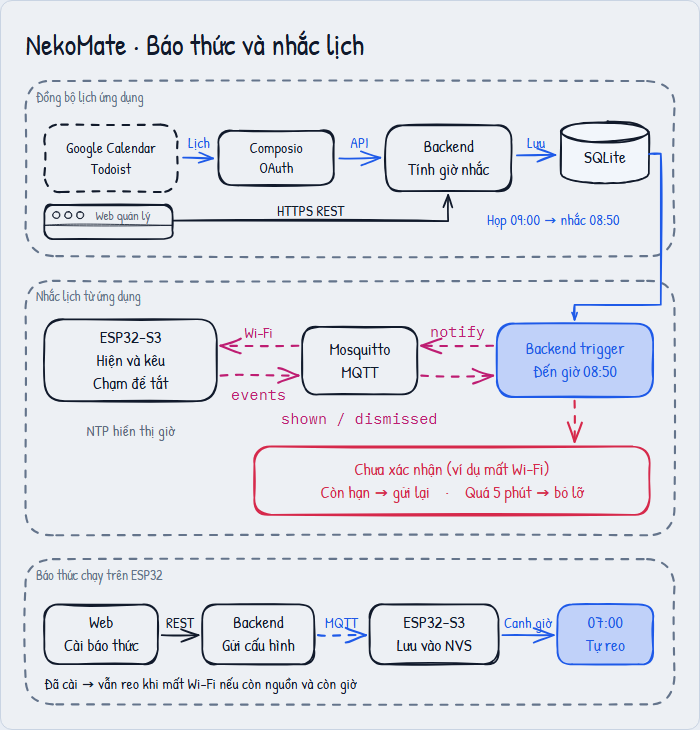

# Thiết kế hệ thống NekoMate

NekoMate là đồng hồ để bàn có màn hình, cảm biến chạm và loa 8 Ω / 3 W qua module MAX98357. **Báo thức do người dùng đặt chạy ngay trên ESP32.** Lời nhắc từ các ứng dụng đã kết nối qua Composio do backend canh giờ và gửi qua MQTT. Cả hai dùng màn hình, loa và thao tác chạm để tắt trên đồng hồ.

## Phạm vi bản đầu

- Một người dùng, một ESP32-S3, một báo thức có giờ và ngày lặp. Bắt đầu tích hợp bằng Google Calendar và Todoist, sau đó thêm Outlook Calendar, Microsoft To Do, TickTick và Google Tasks theo quy tắc thời gian của từng nguồn.
- Web cho phép cài giờ và các ngày báo thức, bật/tắt báo thức, liên kết tài khoản, đồng bộ ngay, xem lời nhắc sắp tới và gửi lời nhắc thử.
- Đồng bộ một chiều xuống đồng hồ. Chạm để xác nhận lời nhắc trên NekoMate. Các thao tác sửa lịch và hoàn thành việc thực hiện trong ứng dụng nguồn.
- Giữ thao tác chạm TTP223 và biểu cảm từ firmware mẫu. ESP32 hiển thị giờ bình thường, hiện tiêu đề và nguồn khi nhận lệnh nhắc, phát tiếng qua MAX98357. Danh sách lời nhắc sắp tới xem trên web.

## Kiến trúc

- **Backend Node.js và TypeScript** phục vụ web HTML/CSS/JS và REST API, quản lý thiết bị, gọi Composio và tính giờ nhắc. Tác vụ đồng bộ nguồn và tác vụ gửi lời nhắc đến hạn chạy chung tiến trình với API trong bản đầu.
- **SQLite** lưu cấu hình báo thức do web đặt, phiên bản ESP32 đã xác nhận, lịch ứng dụng và hàng đợi lời nhắc theo thiết bị.
- **Mosquitto** chuyển cấu hình báo thức và từng lệnh nhắc xuống ESP32. Nó cũng chuyển trạng thái và xác nhận về backend. Topic riêng theo thiết bị giúp áp dụng quyền đọc và ghi tương ứng.
- **ESP32** lấy giờ qua NTP để hiển thị, chạy báo thức và kiểm tra hạn lệnh. Firmware lưu cấu hình báo thức trong NVS. Lời nhắc MQTT đang hiện và các mã lệnh gần đây nằm trong RAM. REST phục vụ web.

### Xác thực và dữ liệu

Một tài khoản chủ thiết bị dùng mật khẩu xác minh bằng `scrypt`. Backend đọc chuỗi salt và hash từ `OWNER_PASSWORD_HASH`, giới hạn lần đăng nhập sai, tạo token ngẫu nhiên mới khi đăng nhập và chỉ lưu hash token trong `sessions`. Cookie `HttpOnly`, `SameSite=Lax`, `Secure` khi qua HTTPS. Phiên hết hạn sau 24 giờ và bị thu hồi khi đăng xuất. `POST /api/auth/login` mở cho khách. Các API còn lại cần phiên chủ. Các yêu cầu thay đổi kiểm tra `Origin` theo `APP_BASE_URL`.

Callback OAuth là điều hướng GET cùng origin đến `APP_BASE_URL`. Nó yêu cầu phiên chủ đã mở Connect Link, nonce dùng một lần trong 10 phút và kết nối Composio đã xác minh thuộc đúng chủ và toolkit. Trạng thái liên kết chờ nằm trong `oauth_attempts` để sống qua lần khởi động lại. Các bảng còn lại là `alarm_config`, `sources`, `source_items` và `notification_queue`. Web polling `GET /api/device` mỗi 3 giây khi tab đang mở để cập nhật trạng thái đồng bộ.

## Hai luồng báo

| Loại | Dữ liệu lưu ở đâu | Ai phát lệnh khi đến giờ | Khi ESP32 mất Wi-Fi |
| --- | --- | --- | --- |
| Báo thức NekoMate, ví dụ 07:00 | ESP32 giữ cấu hình đã áp dụng. Backend giữ bản cấu hình web mới nhất. | ESP32 tự canh giờ và phát tiếng qua loa. | Vẫn reo khi thiết bị còn nguồn và có giờ hợp lệ. |
| Nhắc từ ứng dụng đã kết nối | Lịch và hàng đợi ở SQLite. | Backend gửi lệnh MQTT khi đến giờ nhắc. | Backend thử lại trong khoảng còn hạn. |

### Cài báo thức từ web

1. Người dùng đặt giờ địa phương, ngày lặp và bật/tắt. Khi `enabled=true`, `days` phải có ít nhất một ngày. Backend lưu rồi gửi cấu hình với `configId` ngẫu nhiên cho mỗi lần lưu và `revision` nguyên dương. Bản đầu dùng `Asia/Ho_Chi_Minh`, tương ứng POSIX TZ `ICT-7` trên ESP32.
2. ESP32 lưu cấu hình mới hợp lệ vào NVS trước khi trả `alarm_config_applied`. Web hiển thị **Chờ đồng bộ** cho đến khi ACK khớp cả `configId` và `revision`. Khi nhận lại đúng cặp đã lưu, thiết bị gửi lại ACK. Với bản cũ hoặc cùng revision nhưng khác ID, thiết bị gửi `alarm_config_stale` kèm revision đang lưu. Backend chỉ xử lý phản hồi khớp bản đang chờ, lưu `max(revision đang chờ, appliedRevision) + 1` và gửi lại cùng `configId`. Cách này phục hồi khi SQLite được tạo lại mà ESP32 vẫn giữ cấu hình cũ. Backend giữ im khi DB rỗng cho đến khi chủ thiết bị chủ động lưu cấu hình. [Espressif Arduino Preferences](https://docs.espressif.com/projects/arduino-esp32/en/latest/api/preferences.html)
3. Đến phút đã đặt, ESP32 phát báo thức một lần cho mốc đó trong ngày, tối đa 90 giây. Chạm tắt ngay tại chỗ. Báo thức ưu tiên loa và màn hình khi trùng với lời nhắc ứng dụng. Nếu thiết bị chưa thể hiện lời nhắc mới, nó để backend gửi lại trong hạn.
4. Mất Wi-Fi sau khi đã lấy giờ vẫn cho phép báo thức chạy khi thiết bị còn nguồn. Mất điện xóa mốc giờ hệ thống, còn cấu hình vẫn trong NVS. Khi bật lại, đồng hồ chờ NTP hoặc đọc RTC có pin dự phòng nếu cần chạy ngay khi mạng vẫn mất. Muốn phát báo thức trong lúc mất điện thì ESP32 và mạch khuếch đại cần nguồn dự phòng. [Espressif ESP32-S3 System Time](https://docs.espressif.com/projects/esp-idf/en/latest/esp32s3/api-reference/system/system_time.html)

## Âm thanh

Firmware phát PCM qua I²S cho MAX98357 và loa 8 Ω / 3 W. Sơ đồ lập kế hoạch tạm chọn GPIO5 → BCLK, GPIO6 → LRC/WS và GPIO7 → DIN. GPIO4 giữ cho TTP223. Trước khi thử thật, xác nhận pinout của module đã hàn, phiên bản A/B và đường cấp nguồn trên board mở rộng. MAX98357A dùng I²S chuẩn, MAX98357B dùng dữ liệu left-justified. Loa nối giữa SPK+ và SPK−. [Datasheet MAX98357A/B](https://www.analog.com/media/en/technical-documentation/data-sheets/MAX98357A-MAX98357B.pdf) · [Sơ đồ chân breakout tham khảo](https://learn.adafruit.com/adafruit-max98357-i2s-class-d-mono-amp/pinouts)

Arduino-ESP32 3.x dùng `ESP_I2S.h` và `I2SClass` cho MAX98357A. Chốt gain và SD theo module thực tế. Dùng cấu hình SD mặc định của module cho bản đầu, đánh giá tiếng bụp và nhiễu khi kiểm thử phần cứng. Wokwi chạy logic giờ, chạm, màn hình và MQTT với tín hiệu phát/dừng qua Serial. Chế độ mô phỏng có lệnh Serial đặt thời điểm, tiến giờ, nạp cấu hình và tắt/mở mạng ảo. Kiểm thử đường I²S, âm lượng và nguồn cần ESP32-S3 với amp và loa thật. [Arduino ESP32 I²S](https://docs.espressif.com/projects/arduino-esp32/en/latest/api/i2s.html) · [Hỗ trợ mô phỏng ESP32 của Wokwi](https://docs.wokwi.com/guides/esp32#simulation-features)

## Hiển thị

Web và SQLite giữ nguyên tiêu đề Unicode. Backend tạo tiêu đề riêng cho MQTT bằng cách bỏ dấu tiếng Việt, đổi `đ/Đ` thành `d/D`, chuẩn hóa khoảng trắng và lọc ký tự ngoài ASCII in được, kể cả emoji. Giới hạn 48 ký tự với dấu `...` nằm trong giới hạn. Dùng `Loi nhac` nếu kết quả rỗng và ngắt dòng theo chiều rộng màn. Adafruit GFX dùng font có sẵn. ESP32 cập nhật riêng vùng mắt, giờ và tiêu đề khi nội dung đổi. Chuyển trang mới vẽ lại nền. Chớp mắt dùng mốc `millis()` để vòng lặp tiếp tục xử lý chạm và âm thanh. [Adafruit GFX](https://learn.adafruit.com/adafruit-gfx-graphics-library?view=all)

## Liên kết và đồng bộ lịch

1. Chủ đồng hồ đăng nhập vào web NekoMate rồi yêu cầu tạo Connect Link cho nguồn cần liên kết. Backend dùng Composio session theo `userId` nội bộ và gọi `session.authorize()`. Người dùng cấp quyền tại trang do Composio cung cấp. Backend gắn callback với phiên đã khởi tạo liên kết và xác minh tài khoản vừa kết nối trước khi đồng bộ.
2. Backend dùng `COMPOSIO_API_KEY` từ biến môi trường và gọi `session.execute()` theo tên tool cố định. Google Calendar dùng `GOOGLECALENDAR_EVENTS_LIST`. Todoist dùng `TODOIST_GET_ALL_TASKS`. OAuth cấp quyền truy cập dữ liệu người dùng. API key cấp quyền cho backend gọi Composio. Chọn quyền đọc khi cấu hình nguồn và giữ khóa phía server. [Composio Authentication](https://docs.composio.dev/docs/authentication) · [Session SDK](https://docs.composio.dev/reference/sdk-reference/typescript/session) · [Google Calendar toolkit](https://docs.composio.dev/toolkits/googlecalendar) · [Todoist toolkit](https://docs.composio.dev/toolkits/todoist)
3. Đồng bộ khi vừa liên kết, khi bấm **Đồng bộ ngay** và mỗi 5 phút. Cửa sổ đọc lịch tính theo UTC từ `now - 15 phút` đến `now + 7 ngày`. Mỗi nguồn xử lý tuần tự cả đồng bộ lẫn đổi danh sách hoặc kết nối. Gộp yêu cầu đồng bộ cùng phạm vi đang chạy. Đọc đủ trang trước khi thay dữ liệu. Khi lỗi, giữ bản tốt gần nhất và hiện trạng thái trên web.
4. Backend cập nhật lịch và các lệnh chờ trong cùng giao dịch SQLite. Khi dời giờ, hủy lệnh cũ rồi tạo lệnh cho mốc mới. Khi chỉ đổi tiêu đề, cập nhật nội dung của lệnh chưa xác nhận cùng ID. Khi hủy sự kiện hoặc hoàn thành việc, hủy lệnh đang chờ. Với kết nối Outlook đã có, xin cấp lại quyền đọc cần thiết khi chủ bật Microsoft To Do mà kết nối hiện tại chỉ có quyền lịch. Giữ kết nối đang chạy cho tới khi xác minh quyền mới.
5. Có thể thêm trigger Composio để yêu cầu đồng bộ sớm khi nguồn hỗ trợ sự kiện cần dùng. Backend xác minh chữ ký và xử lý trùng khi nhận webhook. Tác vụ theo giờ ở backend vẫn quyết định lúc nào phát lệnh. [Composio Triggers](https://docs.composio.dev/kb/guide/platform-triggers) · [Nhận sự kiện và xác minh webhook](https://docs.composio.dev/docs/setting-up-triggers/subscribing-to-events)

### Quy tắc mặc định

| Nguồn | Giờ báo | Khi dữ liệu thay đổi |
| --- | --- | --- |
| Google Calendar | Trước giờ bắt đầu 10 phút. Ví dụ họp lúc 09:00 thì mốc báo là 08:50. Lịch cả ngày xuất hiện trên web. | Mở rộng lịch lặp thành từng buổi. Sau khi đồng bộ, dời hoặc hủy lệnh đang chờ theo buổi tương ứng. |
| Todoist | Đúng giờ `due` của việc đang mở. Việc chỉ có ngày xuất hiện trên web. | Cập nhật mốc khi sửa hạn. Hủy lệnh đang chờ cho việc đã hoàn thành hoặc đã xóa. |
| Outlook Calendar | Trước giờ bắt đầu 10 phút. Lịch cả ngày xuất hiện trên web. | Xử lý từng lần xuất hiện trong calendar view. |
| Microsoft To Do | Dùng `reminderDateTime` khi `isReminderOn` bật. | Việc đã hoàn thành hoặc tắt nhắc được rút khỏi hàng đợi. |
| TickTick | Giờ đến hạn có thời điểm rõ ràng, tùy theo dữ liệu tool trả về. | Chỉ lập lệnh cho việc đang mở có giờ. |
| Google Tasks | Hiển thị ngày hạn trên web. API nguồn chỉ cung cấp ngày. | Việc hoàn thành hoặc xóa được bỏ khỏi danh sách. |

Lưu thời điểm theo UTC và hiển thị theo `Asia/Ho_Chi_Minh` mặc định. Với giờ Todoist thiếu múi giờ, dùng múi giờ đã chọn trên NekoMate. Khi hỏi Google Calendar, dùng `singleEvents` và lấy đủ khoảng thời gian để bao gồm độ lệch nhắc trước và khoảng gửi trễ. Mỗi nguồn mới được kiểm tra tool đọc, quyền OAuth, cách phân trang và dữ liệu giờ trước khi bật trên web. [Google Calendar Events API](https://developers.google.com/workspace/calendar/api/v3/reference/events/list) · [Todoist API](https://developer.todoist.com/api/v1/) · [Microsoft Graph To Do](https://learn.microsoft.com/en-us/graph/api/resources/todoTask?view=graph-rest-1.0) · [Google Tasks API](https://developers.google.com/tasks/reference/rest/v1/tasks)

## Hợp đồng giữa backend và đồng hồ

| Topic mẫu | Chiều | Nội dung |
| --- | --- | --- |
| `nekomate/devices/{deviceId}/notify` | Backend → ESP32 | Một lệnh gồm `notificationId`, `source`, `title`, `notifyAt` và `expiresAt`. Gửi QoS 1, `retain=false`. |
| `nekomate/devices/{deviceId}/alarms/config` | Backend → ESP32 | `{configId, revision, hour, minute, days, enabled}`. QoS 1, `retain=true`. |
| `nekomate/devices/{deviceId}/events` | ESP32 → Backend | `{type: 'shown' hoặc 'dismissed', notificationId, at}`; `{type: 'alarm_config_applied', configId, revision}`; `{type: 'alarm_config_stale', configId, revision, appliedRevision}`. QoS 1, `retain=false`. |
| `nekomate/devices/{deviceId}/status` | ESP32 → Backend | `{online: true}` sau khi broker xác nhận đăng ký cả hai topic nhận. Last Will `{online: false}`. Cả hai QoS 1, `retain=true`. |

Thời điểm trong MQTT dùng Unix timestamp theo giây. `notificationId` ổn định theo thiết bị, nguồn, mục hoặc kỳ lặp và mốc báo. Worker đọc SQLite mỗi 5 giây để tìm lệnh đã đến `notifyAt`, còn hiệu lực và chưa nhận `shown`. Khi chưa có `shown`, worker thử lại có giãn cách đến `expiresAt`, mặc định 5 phút sau giờ báo. Backend ghi `shown` hoặc `dismissed` theo ID, xử lý lại cùng một sự kiện an toàn. Một `dismissed` hợp lệ cũng cho biết lệnh đã được hiển thị. Lệnh còn hạn được đọc lại từ DB sau khi server khởi động. [Đặc tả MQTT 3.1.1](https://docs.oasis-open.org/mqtt/mqtt/v3.1.1/os/mqtt-v3.1.1-os.html)

- **Nhận lệnh còn hạn** → hiện nội dung và phát tiếng qua loa tối đa 30 giây. Chạm tắt tại chỗ và gửi `dismissed`. Khi báo thức hoặc lời nhắc khác đang chiếm loa, thiết bị bỏ qua ID chưa từng hiện, để trống bộ chống trùng và đợi lần thử tiếp theo. ID đã hiện vẫn trả trạng thái gần nhất khi nhận trùng.
- **Mất Wi-Fi hoặc broker lỗi** → lệnh vẫn chờ trong SQLite. Khi ESP32 trở lại trong 5 phút kể từ giờ báo, nó có thể nhận và báo trễ. Quá hạn, backend đánh dấu `missed` nếu chưa có xác nhận hiển thị. Nếu đường về bị gián đoạn thì trạng thái trên web phản ánh xác nhận backend đã nhận.
- **Nhận trùng hoặc hết hạn** → ESP32 bỏ lệnh đã hết hạn. Với ID đã báo còn trong RAM, ESP32 gửi lại trạng thái gần nhất và giữ loa im. Khởi động lại xóa trạng thái chống trùng trong RAM, vì vậy có thể báo lại nếu lần trước đã kêu nhưng backend chưa nhận xác nhận.
- **Khi đi qua Internet** → web và REST dùng HTTPS cùng phiên đăng nhập của chủ thiết bị. MQTT dùng TLS và tài khoản riêng cho thiết bị. Broker chỉ cấp cho ESP32 quyền đọc cấu hình, nhận lệnh và gửi trạng thái trên các topic của nó. Khóa Composio ở backend.

Firmware dùng ESP-MQTT sau khi xác nhận build với core Arduino-ESP32 đã khóa phiên bản. Callback sao chép bản tin vào hàng đợi hữu hạn. Vòng chính sở hữu NVS, màn hình, loa và trạng thái báo thức. Việc ghi vào outbox MQTT thực hiện từ task mạng. Trên Docker, broker có listener `1883 0.0.0.0` trong container và bắt buộc thông tin đăng nhập. Mặc định publish cổng ra loopback của host. [ESP-MQTT](https://docs.espressif.com/projects/esp-mqtt/en/stable/esp32/) · [Mosquitto 2.0](https://mosquitto.org/documentation/migrating-to-2-0/)

## Môi trường và thứ tự triển khai

1. **Wokwi với dữ liệu mẫu.** Thêm màn giờ, nút nhấn giả lập TTP223 và tín hiệu mô phỏng phát âm thanh. Kiểm tra báo thức đã cài vẫn kích hoạt sau khi ngắt Wi-Fi mà còn nguồn. Dùng một máy gửi MQTT lệnh thử và kiểm tra chống kêu lặp khi nhận lại cùng ID.
2. **Thử giao tiếp qua MQTT.** Chạy backend, SQLite và Mosquitto cùng một máy. Thử đổi báo thức từ web khi đồng hồ ngoại tuyến, kiểm tra giờ cũ được giữ cho tới khi bản mới áp dụng. Nếu dùng Wokwi web, dùng broker thử nghiệm có xác thực với dữ liệu giả, hoặc Private Gateway để truy cập broker trong LAN. Khi dùng ESP32 thật, có thể giữ toàn bộ backend và broker trên PC cùng mạng để demo. [Hướng dẫn mạng Wokwi](https://docs.wokwi.com/guides/esp32-wifi)
3. **Tích hợp nguồn theo từng nhóm.** Bắt đầu với Google Calendar và Todoist, rồi thêm các nguồn đã định ở trên. Thử sự kiện lặp, dời, hủy, task có giờ, mục chỉ có ngày và task đã hoàn thành. Ngắt Wi-Fi trước giờ báo rồi nối lại để kiểm tra phát muộn trong thời hạn hoặc bỏ lỡ khi hết hạn.
4. **Chạy hằng ngày.** Đặt backend và broker trên VPS hoặc máy chạy liên tục. Với SQLite, giữ DB trên ổ lưu trữ bền vững để worker có thể đọc lại các lệnh đang chờ khi tiến trình khởi động lại.
